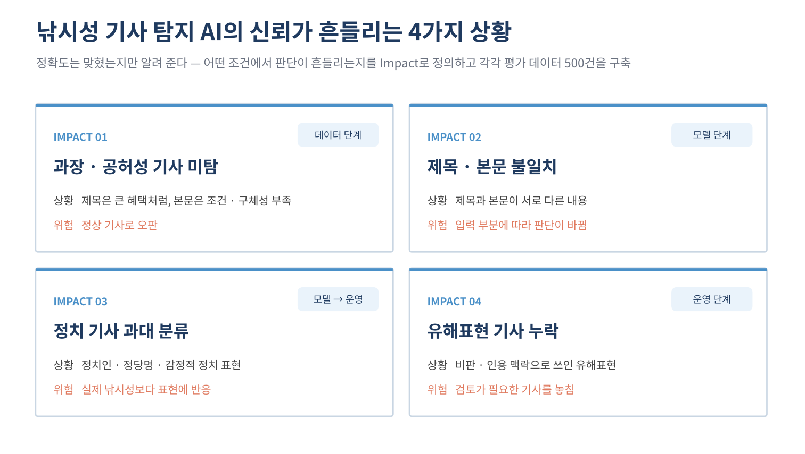
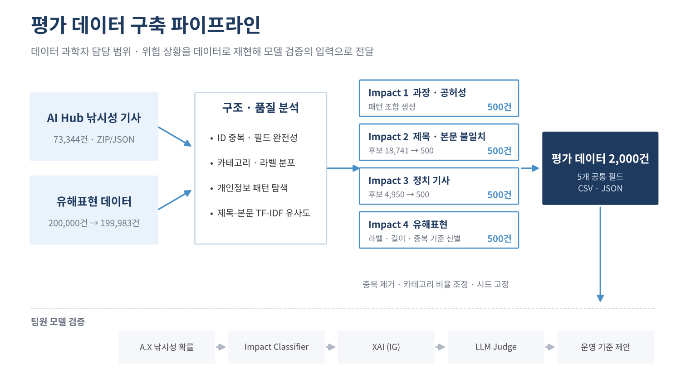
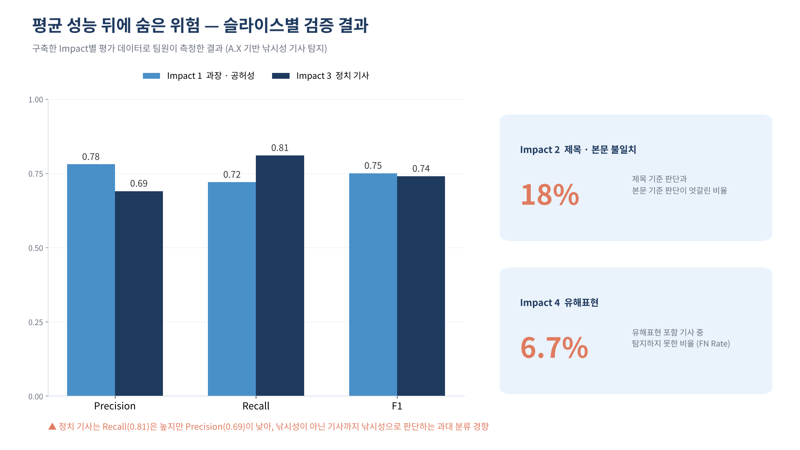

# 📰 SecurAI — 낚시성 기사 탐지 AI 신뢰성 평가 데이터셋

**낚시성 기사 탐지 AI의 판단이 흔들리는 네 가지 상황을 정의하고, 상황별 평가 데이터 2,000건을 구축 · 검증한 데이터 파이프라인**

> 🏅 제1회 TRAITHON 투명성상 (전체 4등) · Team SecurAI
> 이 저장소는 **데이터 과학 파트**(데이터 분석 · 평가 데이터 구축 · EDA · 검증)를 담고 있습니다.

<br>

## 📋 소개

낚시성 기사 탐지 모델의 평균 정확도만으로는 특정 유형의 기사에서 생기는 오판과 편향을 알 수 없습니다.
이 프로젝트는 위험이 드러나는 조건을 **데이터로 재현**해, 팀이 XAI와 LLM Judge로 슬라이스별 신뢰성을 검증할 수 있게 했습니다.

<br>

## ⚠️ 네 가지 Impact

| # | Impact | 설명 | 데이터 |
|:-:|---|---|---|
| 1 | 과장 · 공허성 미탐 | 과장된 제목 + 정보가 부족한 본문 | 패턴 조합 생성 500건 |
| 2 | 제목 · 본문 불일치 | 제목과 본문 주제가 다름 | 후보 18,741건 → 500건 |
| 3 | 정치 기사 과대 분류 | 정치 표현에 과민 반응 | 후보 4,950건 → 500건 |
| 4 | 유해표현 기사 누락 | 비판 · 인용 맥락의 유해표현 | 유해표현 데이터 기반 500건 |

모든 데이터는 공통 스키마로 통일했습니다.

```
newsCategory | newsSubcategory | newsTitle | newsContent | useType
```

<br>





<br>

## 🔍 EDA · 품질 검증

| 항목 | 결과 |
|---|---|
| 뉴스 데이터 | 73,344건, 기사 ID 100% 고유, 핵심 필드 완전성 100% |
| 카테고리 분포 | 최대 비중 약 20.2% |
| 제목 · 본문 유사도 | TF-IDF 코사인 유사도로 불일치 분포 확인 |
| 유해표현 데이터 | 200,000건 → 중복 17건 제거 → 199,983건 |
| 개인정보 패턴 | 전화번호 · 이메일 · 주민번호 형태 탐색 |

<br>

## 📊 팀 모델 검증 결과 (모델 개발자 수행)

| 슬라이스 | 결과 |
|---|---|
| 과장 · 공허성 | P 0.78 · R 0.72 · F1 0.75 |
| 제목 · 본문 불일치 | 판단 불일치율 18% |
| 정치 기사 | P 0.69 · R 0.81 · F1 0.74 |
| 유해표현 | FN Rate 6.7% |



검증 방법: A.X 모델 낚시성 확률, TF-IDF + Logistic Regression Impact Classifier, Integrated Gradients(XAI), LLM Judge

<br>

## 🛠️ 기술 스택

Python · pandas · scikit-learn (TF-IDF, Cosine Similarity) · Matplotlib · Jupyter · JSON/CSV 처리

<br>

## 📁 구조

```
├── notebooks/
│   ├── 00_source_data_audit.ipynb        # 원천 데이터 완전성 · 중복 · 개인정보 패턴 · 분포 점검
│   ├── 01~04_impactN_dataset.ipynb       # Impact별 평가 데이터 생성 · 추출 (각 500건)
│   ├── 05_eda_figures.ipynb              # EDA · 시각화 (카테고리 분포, 제목·본문 유사도)
│   └── 06_evidence.ipynb                 # 품질 검증 · Impact별 위험 신호 근거 CSV
├── evidence/                             # 집계형 검증 결과 CSV (기사 원문 미포함)
│   └── data_quality/                     # 원천 데이터 품질 점검 결과
├── figures/                              # 카테고리 분포 · 유사도 분포 등
└── data/                                 # 원천 · 평가 데이터 (저장소에 미포함, 아래 참고)
```

<br>

## 🗂️ 데이터

원천 데이터는 재배포 조건에 따라 저장소에 포함하지 않았습니다. 아래 위치에 두면 노트북이 그대로 실행됩니다.

| 데이터 | 출처 | 위치 |
|---|---|---|
| 낚시성 기사 탐지 데이터 (Validation 라벨링 ZIP) | AI Hub | `data/raw/clickbait_labels/` |
| 유해표현 검출 AI모델 학습용 데이터 (stage2) | 대회 제공 | `data/raw/harmful/stage2_data.csv` |
| Impact별 평가 데이터 (노트북 01~04 출력) | 직접 구축 | `data/impact/` |

```bash
pip install -r requirements.txt
```

<br>

## 🔧 재현성

- Impact별 추출 조건을 노트북으로 분리
- 난수 시드 고정
- 행 수 · 카테고리 분포 자동 확인
- 원천 데이터 출처 · 처리 단계 기록

<br>

## 📌 운영 제안

- 정보 부족 · 설명 불안정 → 자동 판단 보류
- 제목 · 본문 불일치 → 두 입력 함께 사용 + 인간 검토
- 정치 기사 → 별도 임계값
- 유해표현 정책 위험 → 운영 정책 우선

<br>

## 👥 Team SecurAI

| 역할 | 담당 |
|---|---|
| 데이터 과학자 (장하은) | 데이터 분석, Impact별 데이터 구축, EDA, 검증 노트북 · 근거 |
| 기획자 (김희수) | 프로젝트 흐름 기획, 거버넌스 정의 및 산출물 작성 |
| AI 모델 개발자 (오연서, 팀장) | 모델 아키텍처 기획, 평가 지표 정의, A.X · XAI · LLM Judge 검증 |
